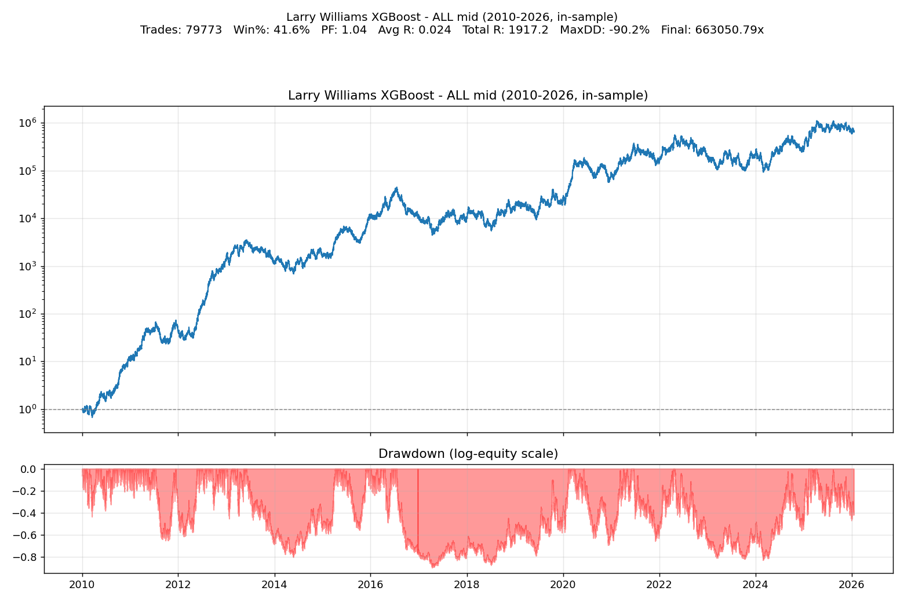
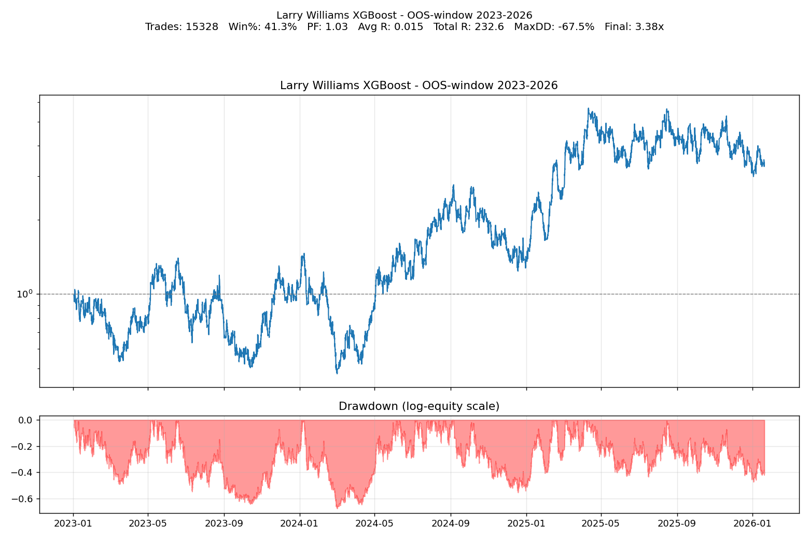
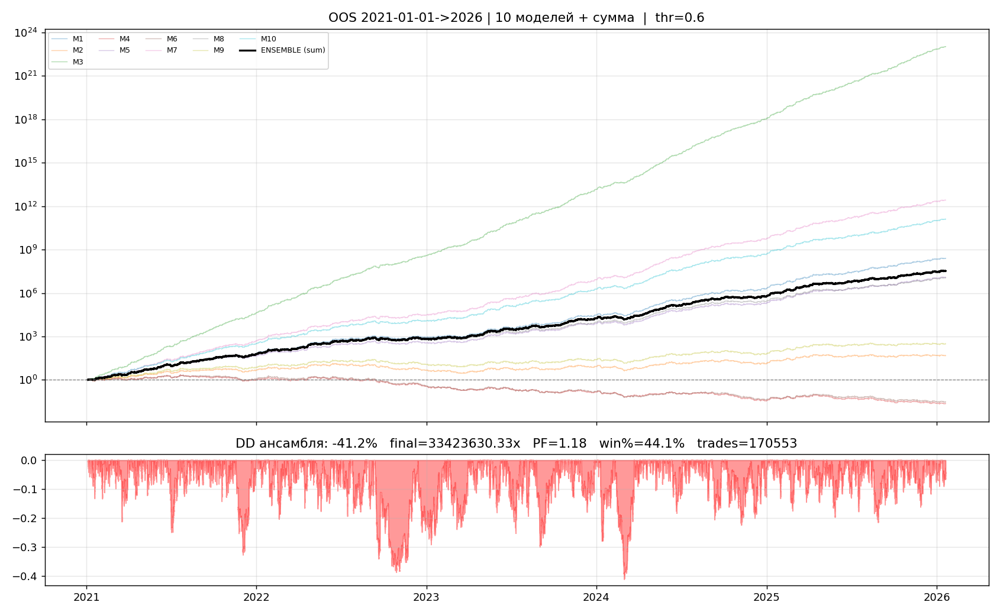
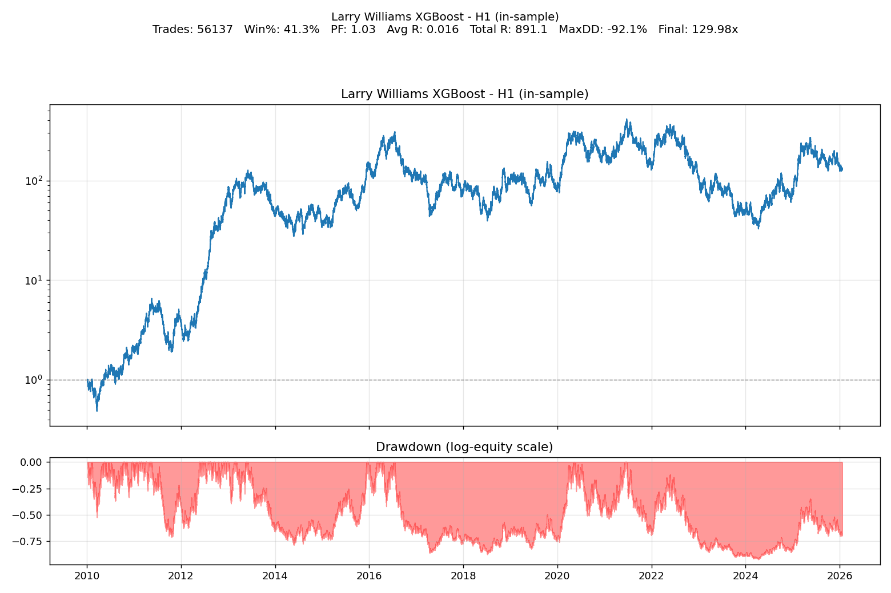
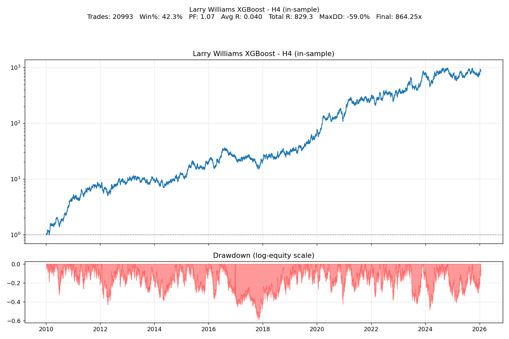
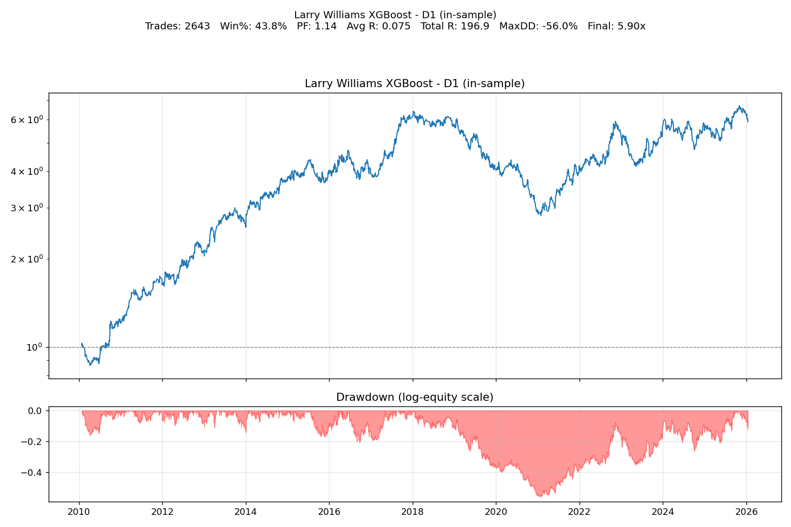
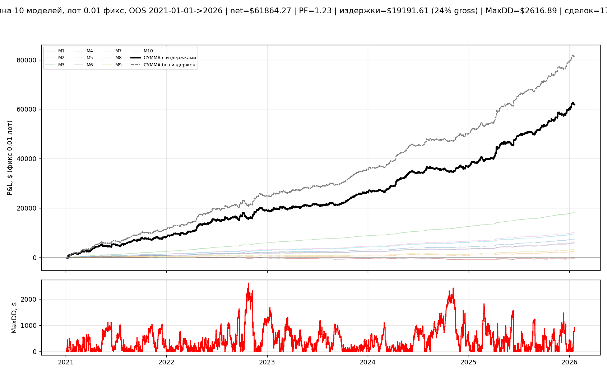
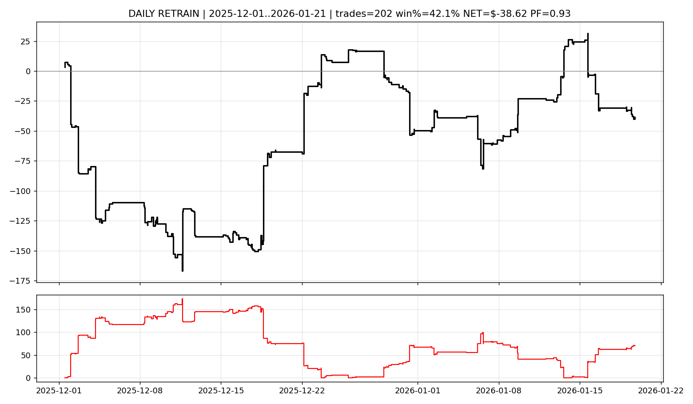
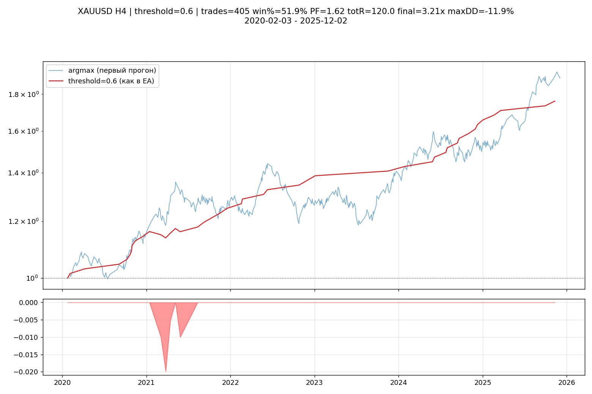
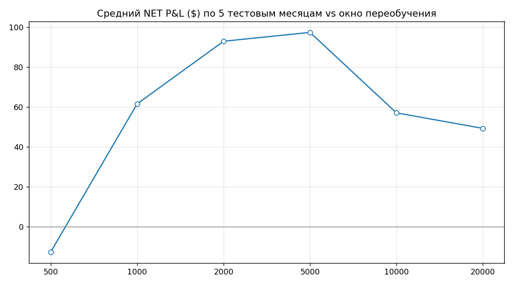

# Larry Williams XGBoost ONNX — эксперт для MetaTrader 5

ML-пайплайн по паттерну «внешняя свеча» (Outside Bar) Ларри Уильямса: фичи → XGBoost-классификатор → конвертация в ONNX для советника MetaTrader 5. Данные — 11 инструментов (forex + XAUUSD) на H1/H4/D1 за 2010–2026 годы.

## 🎯 Суть системы на словах

Стратегия в основе простая: ищутся разворотные «внешние свечи» (low ниже и high выше предыдущей свечи, закрытие за предельной ценой), а по ним — бинарный классификатор «открыть или нет».

1. **Данные.** `download_csv_metatrader5.py` выгружает из MT5 котировки 11 пар (EURUSD, GBPUSD, USDJPY, GBPJPY, EURJPY, AUDUSD, NZDUSD, USDCAD, USDCHF, EURGBP, XAUUSD) на трёх ТФ за период 2010-01-01 → 2026-01-20.

2. **Фичи и разметка.** `build_larry_features()` строит признаки: `is_outside_bull` / `is_outside_bear` (сам паттерн), `BODY_SIZE` (доля тела от диапазона), `REL_RANGE` (диапазон к 10-барному экстремуму), `ATR` (True Range скользящим средним), `RELATIVE_ATR` (размер свечи к ATR), `VOL_CHANGE`, `PREV_DIR`, `DAY`, `HOUR`. Метка — движение цены вперёд на `HORIZON=20` баров с риск-профитом `RR_RATIO=1.5`: вход на открытии следующей свечи, выход по TP/SL.

3. **Обучение.** `train_larry_williams.py` — XGBClassifier с весами классов (`compute_sample_weight`), взвешенная метрика, сохранение `models/larry_model.pkl`. `111.py` — минимальный скрипт для одного инструмента (конфигурируется в начале файла: файл, TRAIN_BARS/TEST_BARS, депозит 10 000, риск 1% на сделку).

4. **ONNX для MT5.** `convert_onnx_larry.py` конвертирует XGBoost в ONNX (`skl2onnx` + `onnxmltools`) с фиксами `base_score` и имён признаков, чтобы советник мог считать предсказание в терминале.

5. **Бэктесты и ансамбль.** `backtest_equity.py` — equity по всем инструментам/ТФ (риск 1%, одинаковые метки); `backtest_xau_h4.py` — отдельный прогон XAUUSD H4 под логику EA; `ensemble_walkforward.py` — walk-forward на ансамбле из 10 наборов гиперпараметров XGBoost (обучение до `TRAIN_CUT='2021-01-01'`, порог входа `THR=0.6`, риск 0.1% на модель, одна позиция за раз); `ensemble_summed_costs.py` — то же с учётом издержек (комиссия/спред, P&L в USD при лоте 0.01); `daily_retrain.py` — ежедневная переобучение модели; `grid_lookback.py` — сетка lookback-периодов с heatmap-графиком.

## 📈 Графики эквити

| Equity (все инструменты) | Equity OOS | Equity ensemble OOS |
|---|---|---|
|  |  |  |

| H1 | H4 | D1 |
|---|---|---|
|  |  |  |

| Суммарно со издержками | Daily retrain | XAUUSD H4 (EA) |
|---|---|---|
|  |  |  |

| Grid lookback |
|---|
|  |

## 📁 Структура папок

| Путь | Назначение |
|------|------------|
| `download_csv_metatrader5.py` | выгрузка котировок из MT5 в `data/` |
| `train_larry_williams.py` | обучение XGBoost, сохранение `models/larry_model.pkl` |
| `convert_onnx_larry.py` | конвертация модели в ONNX для советника MT5 |
| `111.py` | минимальный конфигурируемый бэктест одного инструмента |
| `backtest_equity.py`, `backtest_xau_h4.py` | equity-бэктесты (все пары / XAUUSD H4) |
| `ensemble_walkforward.py`, `ensemble_summed_costs.py` | walk-forward ансамбля из 10 моделей (± издержки) |
| `daily_retrain.py` | ежедневное переобучение |
| `grid_lookback.py` | сетка lookback-периодов |
| `equity_*.png`, `grid_lookback.png` | графики результатов |
| `data/`, `models/` | котировки и модель (в git не попадают, см. `.gitignore`) |
| `requirements.txt` | onnx, skl2onnx, onnxmltools, xgboost, ta, scikit-learn, pandas |

## 🚀 Запуск

```bash
pip install -r requirements.txt
python download_csv_metatrader5.py      # 1. скачать данные в data/
python train_larry_williams.py          # 2. обучить XGBoost -> models/larry_model.pkl
python convert_onnx_larry.py            # 3. получить .onnx для советника MT5
python backtest_equity.py               # 4. equity по всем инструментам
python ensemble_walkforward.py          # 5. walk-forward ансамбля (THR=0.6, риск 0.1% на модель)
```

Для запуска выгрузки данных нужен запущенный терминал MetaTrader 5.

## ⬆️ Что не выгружено в репозиторий

Через `.gitignore` и встроенные `data/.gitignore` / `models/.gitignore` отсечены: `data/*.csv` (86 МБ котировок — восстанавливаются скриптом выгрузки), `models/*.pkl` (5 МБ — переобучаются скриптом), архив `larry_william.zip` (дубликат кода), `__pycache__/`.

---

> **ВНИМАНИЕ:** торговые стратегии на ML — высокий риск, результаты на исторических данных не гарантируют будущую прибыль. Проверяйте на демо.
